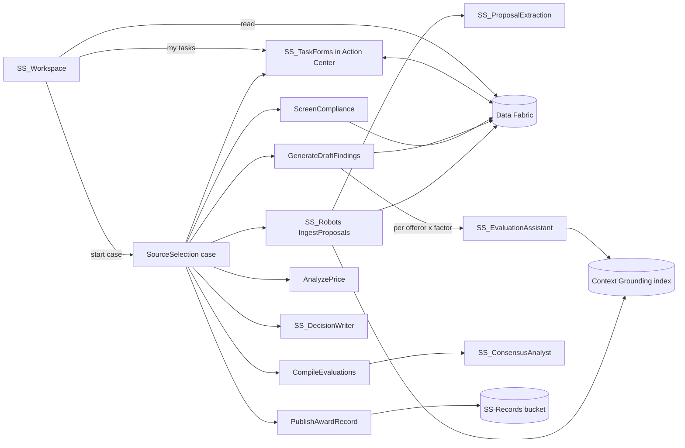

# Solution Design Document — UiPath Source Selection

> **Solution overview SDD.** FAR Part 15 best-value source selection on UiPath, positioned against Appian's acquisition offerings. Ties together the per-project SDDs in §6. Reuse mechanism: one evaluation plan JSON per solicitation.

---

## Document History

| Date | Version | Author | Role | Comments |
|---|---|---|---|---|
| 2026-10-12 | 1.0 | uipath-planner (for anagh.bhave@uipath.com) | Generated by AI Agent | Initial solution SDD from conversational design |

---

<!-- DO NOT RENAME: uipath-planner detects SDDs via this exact heading or the marker below. -->
<!-- planner-handoff:v1 -->
## Planner Handoff

| Field | Value |
|---|---|
| **Status** | ready |
| **Execution autonomy** | autonomous |
| **Delivery model** | cloud |
| **SDD scope** | solution |
| **Solution root SDD** | source-selection-solution-sdd.md |
| **Solution ID** | uipath-source-selection |
| **Project SDD role** | root |
| **Project list section** | §3 Project Inventory + §6 Per-Project SDD Index |
| **Tasks file** | `uipath-source-selection-tasks.md` |
| **Generated by** | uipath-planner |
| **Generation date** | 2026-10-12 |
| **Template validation** | passed |

**Cross-project ordering notes for Lane A:** (1) evaluation plans + synthetic proposal PDFs + Data Fabric entities + buckets + seed → (2) IXP model `SS_ProposalExtraction` → (3) Context Grounding index per solicitation → (4) agents `SS_EvaluationAssistant`, `SS_ConsensusAnalyst`, `SS_DecisionWriter` → (5) RPA `SS_Robots` (GenerateDraftFindings invokes the evaluation agent) → (6) Coded Action App `SS_TaskForms` → (7) case `SourceSelection` (binds 2–6) → (8) Coded Web App `SS_Workspace` (starts cases, reads entities and tasks) → (9) solution pack/deploy → (10) end-to-end runs on both plans.

---

## Decisions Made

| # | Decision | Picked | One-sentence reason |
|---|---|---|---|
| 1 | **Platform constraints** | Cloud (uipathlabs/Playground); no products blocked; Coded Apps confirmed allowed by the user | Maestro/Agents are on Automation Suite 2.2510.2 and arrive on ACPS with Act Two. |
| 2 | **Scope** | Solution(Case Management, 3 Agents, RPA coded, Coded Action App, Coded Web App, IXP, Data Fabric, Context Grounding) | Lifecycle orchestration, judgment drafting, deterministic checks, human decisions and a workspace UI. |
| 3 | **Human decisions** | All evaluation, consensus, price and award decisions are Action Center tasks | FAR 15.305/15.308 independent judgment and protest defensibility. |
| 4 | **Agent grounding** | Context Grounding index over each solicitation's proposals; findings carry offeror, volume and page | Every agent statement is checkable against the source page — the protest trace. |
| 5 | **Reuse mechanism** | `evaluation-plans/<solicitation>.json` drives factors, scales, panel and basis for award | A new solicitation is a new JSON file; nothing is coded per agency. |

---

## Recommended Scope

**Recommendation:** SOLUTION(Case Management, Agents ×3, RPA Process (coded), Coded Action App, Coded Web App, IXP, Data Fabric)
**Delivery model:** cloud
**Blocked by platform:** none
**Need profile:** Shorten source selection cycle time and reduce protest risk by making every rating traceable to a proposal page and a named official.
**Reasoning:**
- Staged lifecycle with named roles, a return loop and an alternate terminal → Case Management
- Drafting findings, consensus language and SSDD from unstructured proposals → Agents grounded with Context Grounding
- Proposal ingestion, compliance/responsibility checks, price math, record publishing → coded RPA
- Price schedules, offeror identity, certifications in semi-structured PDFs → IXP
- Every judgment by a named official → Action Center via a Coded Action App
- Portfolio, matrix, protest trace and persona switching → Coded Web App
**Alternatives considered:**
- Maestro BPMN — rejected: the work is a stage lifecycle with personas and SLAs, a case's native shape.
- Agent scoring proposals — rejected: violates FAR independent-judgment and invites protest.

---

## Action Required — SME Review Items

| # | Section | Item | Question | Default applied | Blocking |
|---|---|---|---|---|---|
| 1 | §5 | SAM.gov live mode | Live SAM.gov needs an api.data.gov key you store yourself | Synthetic SAM/FAPIIS/CPARS mirrors | no |
| 2 | source-selection-sdd §3 | Single-user demo | All persona tasks go to one account | Persona switcher in SS_Workspace; recipients are case inputs | no |
| 3 | §1 | ACPS readiness | Maestro/Agents not on ACPS today | README positions Automation Suite + Act Two | no |

> These items are marked `[SME REVIEW]` in the document. Default-carried items (Blocking = no) do not block task derivation.

---

## Table of Contents

1. Solution Overview · 2. Planner Handoff (above) · 3. Project Inventory · 4. Cross-Project Data Flow · 5. Shared Assets & Queues · 6. Per-Project SDD Index · 7. Evaluation Plans · 8. Non-Functional Requirements · 9. Testing Strategy · 10. Next Steps

---

## 1. Solution Overview

### Objective

Run a complete FAR Part 15 best-value source selection on UiPath: ingest proposals, screen compliance and responsibility, draft evaluator findings with page citations, capture independent evaluations, reach SSEB consensus, evaluate price, and support the SSA's documented award decision — with a protest-ready audit trail.

### Business context (demo story)

- Every agency runs source selections; protests are frequent and costly, and the record must show the evaluation followed the stated criteria.
- Evaluators spend most of their time locating and transcribing evidence; agents can draft with citations so evaluators spend time judging.
- Competitive position: Appian markets acquisition and procurement solutions to federal agencies; this asset shows the same lifecycle with agentic drafting, Maestro case orchestration and a modern coded UI.
- Video beats: (1) CO starts a case for a DoD buy; (2) evaluator reviews agent drafts with the proposal page beside each finding; (3) Chair sees disagreements flagged and signs consensus; (4) SSA signs the SSDD; (5) click any rating → protest trace to the page; (6) swap to the HHS plan and run again.

### Personas

Evaluator (×3), SSEB Chair, Contracting Officer, Source Selection Authority — see source-selection-sdd §3.

### In Scope

Two evaluation plans (DoD IT modernization, HHS research data platform), three synthetic offerors each with generated proposal PDFs, the full case, three agents, robots, IXP, both apps, README and demo script.

### Out of Scope

Discussions/FPRs, debriefings, real vendor data, contract writing systems.

---

## 3. Project Inventory

| # | Project | Product | Sub-type / Mode | Role | SDD |
|---|---|---|---|---|---|
| 1 | `SS_DataModel` | Data Fabric entities + buckets | component | Solicitations, offerors, proposal pages, findings, ratings, consensus, decisions, audit events, reference mirrors | §5 |
| 2 | `SS_ProposalExtraction` | IXP model | component | Price schedule, offeror identity, certifications | `ss-robots-sdd.md` §9 |
| 3 | `SS_Robots` | RPA Process | Coded C#, 7 entry points | All deterministic case tasks | `ss-robots-sdd.md` |
| 4 | `SS_EvaluationAssistant` | Agent | Low-code | Draft findings per offeror × factor with citations | `ss-evaluation-assistant-sdd.md` |
| 5 | `SS_ConsensusAnalyst` | Agent | Low-code | Disagreements + consensus draft | `ss-consensus-analyst-sdd.md` |
| 6 | `SS_DecisionWriter` | Agent | Low-code | Comparative analysis + SSDD draft | `ss-decision-writer-sdd.md` |
| 7 | `SS_TaskForms` | Coded Action App | React, code-switched by actionType | All six human tasks | `ss-task-forms-sdd.md` |
| 8 | `SourceSelection` | Case Management | — | Lifecycle orchestration | `source-selection-sdd.md` |
| 9 | `SS_Workspace` | Coded Web App | React + SDK | Portfolio, persona inbox, matrix, protest trace, start case | `ss-workspace-sdd.md` |
| — | Repo assets | — | Python + JSON | `evaluation-plans/`, `tools/` (proposal PDF generator, seeder), README, demo script | §7 |

## 4. Cross-Project Data Flow



## 5. Shared Assets & Queues

### Data Fabric entities (prefix `SS`, all string/number fields — no choice sets)

| Entity | Key fields | Written by | Read by |
|---|---|---|---|
| `SSSolicitation` | SolicitationId, Title, Agency, PlanJson, Status, Stage, CaseInstanceId, AwardeeName | Workspace, robots | all |
| `SSOfferor` | OfferorId, SolicitationId, Name, UEI, CAGE, SamStatus, Exclusion, ComplianceStatus, ComplianceNotes, TotalEvaluatedPrice | IngestProposals, ScreenCompliance, AnalyzePrice | all |
| `SSProposalPage` | PageId, OfferorId, Volume, PageNumber, Text | IngestProposals | TaskForms (page viewer), Workspace (trace) |
| `SSFinding` | FindingId, SolicitationId, OfferorId, FactorId, Kind (Strength/Weakness/SignificantWeakness/Deficiency/Risk), Text, CitationVolume, CitationPage, CitationQuote, Author (agent/evaluator email), Status (Draft/Accepted/Edited/Rejected/Added), EvaluatorSlot, Version | GenerateDraftFindings, TaskForms | TaskForms, agents, Workspace |
| `SSRating` | RatingId, SolicitationId, OfferorId, FactorId, Level (Individual/Consensus), EvaluatorSlot, Rating, Rationale, RatedBy, RatedAt | TaskForms | Compile, agents, Workspace |
| `SSDecision` | DecisionId, SolicitationId, Kind (Release/Consensus/Price/Award/Cancel), Outcome, Rationale, DecidedBy, DecidedAt, DocumentText | TaskForms, robots | Workspace, PublishAwardRecord |
| `SSAuditEvent` | EventId, SolicitationId, EntityRef, Action, Actor, At, Detail | all writers | Workspace (protest trace) |
| `SSRefVendor` | UEI, LegalName, SamStatus, RegistrationExpiry, Exclusion, FapiisRecords, CparsSummaryJson | seed | ScreenCompliance, EvaluationAssistant (past performance) |

### Orchestrator resources (folder `Shared/SourceSelection`)

| Resource | Type | Purpose |
|---|---|---|
| `SS-Proposals` | Storage bucket | `<solicitationId>/<offerorId>/<volume>.pdf` |
| `SS-Records` | Storage bucket | SSDD, SSEB report, audit package PDFs |
| `SS-Proposals-<solicitationId>` | Context Grounding index | Proposal text with page metadata per solicitation |
| `SS_SamApiKey` | Secret asset (optional) | Live SAM.gov; user populates [SME REVIEW] |

## 6. Per-Project SDD Index

| File | Scope |
|---|---|
| `source-selection-sdd.md` | Case `SourceSelection` |
| `ss-robots-sdd.md` | RPA `SS_Robots` + IXP model contract |
| `ss-evaluation-assistant-sdd.md` | Agent `SS_EvaluationAssistant` |
| `ss-consensus-analyst-sdd.md` | Agent `SS_ConsensusAnalyst` |
| `ss-decision-writer-sdd.md` | Agent `SS_DecisionWriter` |
| `ss-task-forms-sdd.md` | Coded Action App `SS_TaskForms` |
| `ss-workspace-sdd.md` | Coded Web App `SS_Workspace` |

## 7. Evaluation Plans

`evaluation-plans/<solicitationId>.json` — the reuse contract.

```json
{
  "solicitationId": "FA8771-27-R-0012",
  "title": "Enterprise IT Modernization Services",
  "agency": "Department of the Air Force",
  "basisForAward": "Best value tradeoff",
  "relativeImportance": "Technical is more important than Past Performance; non-price factors combined are significantly more important than price.",
  "factors": [
    { "id": "F1", "name": "Technical Approach", "weight": 1, "scale": "technical", "subfactors": ["Cloud migration methodology", "Cybersecurity and ATO approach"] },
    { "id": "F2", "name": "Management Approach", "weight": 2, "scale": "technical" },
    { "id": "F3", "name": "Past Performance", "weight": 3, "scale": "confidence" },
    { "id": "PRICE", "name": "Price", "evaluatedNotRated": true }
  ],
  "scales": {
    "technical": ["Outstanding", "Good", "Acceptable", "Marginal", "Unacceptable"],
    "confidence": ["Substantial Confidence", "Satisfactory Confidence", "Neutral Confidence", "Limited Confidence", "No Confidence"]
  },
  "panel": { "evaluators": [ { "slot": 1, "factors": ["F1", "F2"] }, { "slot": 2, "factors": ["F1", "F2"] }, { "slot": 3, "factors": ["F1", "F3"] } ] },
  "igce": 23800000,
  "submission": { "volumes": ["technical", "management", "pastPerformance", "price"], "pageLimits": { "technical": 25, "management": 15 } }
}
```

Second plan: `75N910-27-R-0044` — HHS / NIH "Research Data Platform", factors Technical Capability, Key Personnel, Past Performance, Price.

## 8. Non-Functional Requirements

- **Security / source selection information:** synthetic data; all resources in one folder; proposal content never leaves the tenant (Context Grounding + AI Trust Layer).
- **Auditability:** every finding and rating is versioned with author and timestamp; `SSAuditEvent` records each change; the protest trace reads only recorded facts.
- **Performance:** a 3 offeror × 3 factor plan drafts in one robot job (9 agent runs).
- **Demo reliability:** seeded completed case history for the portfolio; reset script restores a clean solicitation between takes.

## 9. Testing Strategy

- Per project: see child SDDs.
- Golden plans: both plans ship synthetic proposals with planted discriminators (e.g., one offeror misses the ATO approach → weakness; one has a FAPIIS record → past performance risk; one price line unbalanced). E2E asserts the agent drafts cite the planted pages.
- Paths: happy, reconvene, cancel-at-release, cancel-at-price, SLA notification.
- Reuse: run the HHS plan with zero code change.

## 10. Next Steps

1. Lane A derives `uipath-source-selection-tasks.md` from this root and the child SDDs.
2. Build in the ordering notes above.
3. Terminal artefact: packed `.uipx` via `uipath-solution`, deployed to Playground.
