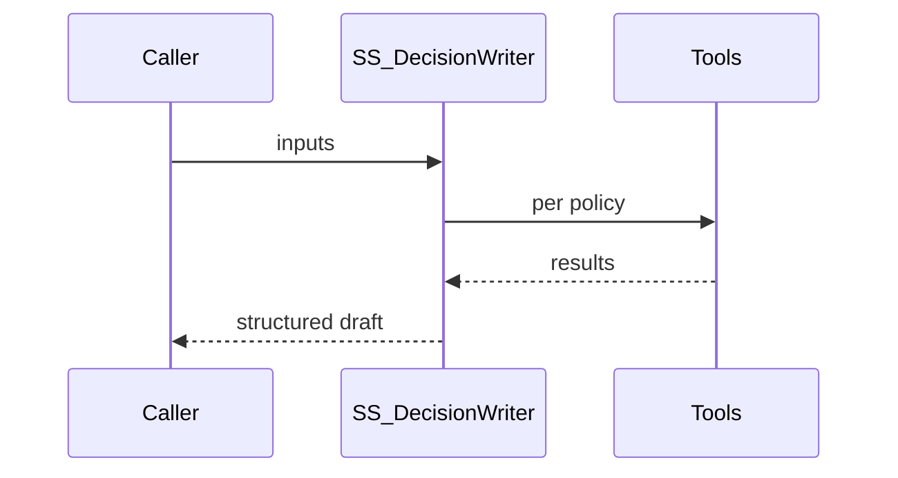

# Solution Design Document — SS_DecisionWriter

> **Template:** UiPath Agent — low-code (`agent.json`). Child of `source-selection-solution-sdd.md`.

---

## Document History

| Date | Version | Author | Role | Comments |
|---|---|---|---|---|
| 2026-10-12 | 1.0 | uipath-planner | Generated by AI Agent | Initial SDD |

---

<!-- DO NOT RENAME: uipath-planner detects SDDs via this exact heading or the marker below. -->
<!-- planner-handoff:v1 -->
## Planner Handoff

| Field | Value |
|---|---|
| **Status** | ready |
| **Execution autonomy** | autonomous |
| **Delivery model** | cloud |
| **SDD scope** | solution |
| **Solution root SDD** | source-selection-solution-sdd.md |
| **Solution ID** | uipath-source-selection |
| **Project SDD role** | child |
| **Independently executable** | no — Lane A derives tasks only via the Solution root |
| **Project list section** | §3 Tools + §8 Integrated Components + §9 Project Structure |
| **Tasks file** | `uipath-source-selection-tasks.md` |
| **Generated by** | uipath-planner |
| **Generation date** | 2026-10-12 |
| **Template validation** | passed |

---

## Decisions Made

| # | Decision | Picked | One-sentence reason |
|---|---|---|---|
| 1 | **Platform constraints** | Cloud; AI Trust Layer default model | No products blocked. |
| 2 | **Framework** | Low-code `agent.json` | Structured single-purpose drafting, editable in Agent Builder by any SE. |
| 3 | **Authority** | Drafts and recommends only | FAR 15.305/15.308: officials rate and decide. |

---

## Recommended Scope

**Recommendation:** SOLUTION(...) — this file covers SS_DecisionWriter
**Delivery model:** cloud
**Blocked by platform:** none
**Need profile:** Cut evaluator and decision-maker drafting time while keeping every statement traceable.

---

## Table of Contents

1. Agent Overview · 2. Agent Framework · 3. Tools · 4. Memory / RAG · 5. Evaluation Criteria · 6. Orchestrator Bindings · 7. Error Handling & Escalation · 8. Integrated Components · 9. Project Structure · 10. Testing Strategy · 11. Next Steps

---

## 1. Agent Overview

Drafts the comparative best-value analysis and Source Selection Decision Document from the plan's basis for award and relative importance, the consensus ratings with supporting findings, and the price analysis. Recommends — never decides — an awardee and explains the tradeoff.

### In Scope

Comparative analysis, tradeoff rationale, SSDD draft, recommended awardee.

### Out of Scope

Assigning ratings, making decisions, contacting offerors, using information outside the provided record.

### Assumptions

Proposals and plans are synthetic; model selected by the AI Trust Layer default.

## 2. Agent Framework

Low-code agent. **Input:** `solicitationId`, `consensusRatings` (JSON), `priceAnalysis` (JSON), `plan` (basis for award, relative importance). **Output:** `ssddDraft` (markdown string), `recommendedAwardee` (string), `discriminators` (array). System prompt intent: act as a federal source selection support analyst; use only provided content and tool results; cite every claim; never rate or decide; output strict JSON.

## 3. Tools

| Tool | Type | Binding | Purpose |
|---|---|---|---|
| `GetFindings` | RPA process tool | SS_Robots.CompileEvaluations (read-only) | Fetch supporting findings and citations for discriminators |

### Tool Invocation Policy

Call GetFindings once; cite finding ids and proposal pages for every discriminator; state explicitly that the decision is the SSA's.

### Agent Configuration

| Setting | Value |
|---|---|
| Name | SS_DecisionWriter |
| Temperature | 0 [DEFAULT] |
| Max iterations | 8 [DEFAULT] |
| Guardrails | Output schema validation; citations must reference provided pages/findings |

### Agent Interaction Diagram

## 4. Memory / RAG

### Short-term Memory

Single invocation.

### Long-term Memory

None — the source selection record lives in Data Fabric.

### RAG Sources

None — grounded in the SSEB record only.

## 5. Evaluation Criteria

### Success Metrics

Every discriminator cites a finding id; recommendation consistent with stated relative importance in 100% of eval cases.

### Trajectory Evaluation

Tool calls within policy limits.

### LLM-Judge Criteria

Specific, factual, cites evidence, no rating or decision language attributed to the agent.

## 6. Orchestrator Bindings

Folder `Shared/SourceSelection`; tool bindings as in §3.

## 7. Error Handling & Escalation

### Agent-level errors

Invalid output → caller retries once, then records "Draft unavailable — evaluate manually".

### HITL Escalation

Handled by the case's action tasks; the agent never escalates itself.

## 8. Integrated Components

### RPA Processes Called as Tools

`SS_Robots.CompileEvaluations (read-only)`

### API Workflows Called as Tools

None.

### Integration Service Connectors

None.

### Integration Service Connections

None.

### IXP / Document Understanding Models

None.

### Coded Functions

None.

## 9. Project Structure

### Implementation Mode

Low-code.

### Coded Agent Structure

N/A.

### Low-code Agent Structure

`SS_DecisionWriter/agent.json` + `evals/eval-sets/`.

### Solution / Project Breakdown

One agent project in the solution.

### Reusable Components

Factor criteria and scales come from the evaluation plan, so the agent is solicitation-agnostic.

### Environments (DEV / UAT / PROD)

Playground.

### Non-Functional Requirements

p95 < 60 s per run; inputs/outputs traced.

## 10. Testing Strategy

### Canonical Test Case

Offeror A Outstanding/Substantial at $24.8M vs Offeror C Acceptable at $20.9M → draft justifies paying the premium for the cited technical discriminators, or recommends the lower price if discriminators are minor.

### Evaluation Dataset

≥ 12 cases across both plans, including silent-proposal and conflicting-evidence cases.

### Regression Strategy

Run the eval set on each change; block publish below the success metrics.

## 11. Next Steps

Lane A via the solution root.
