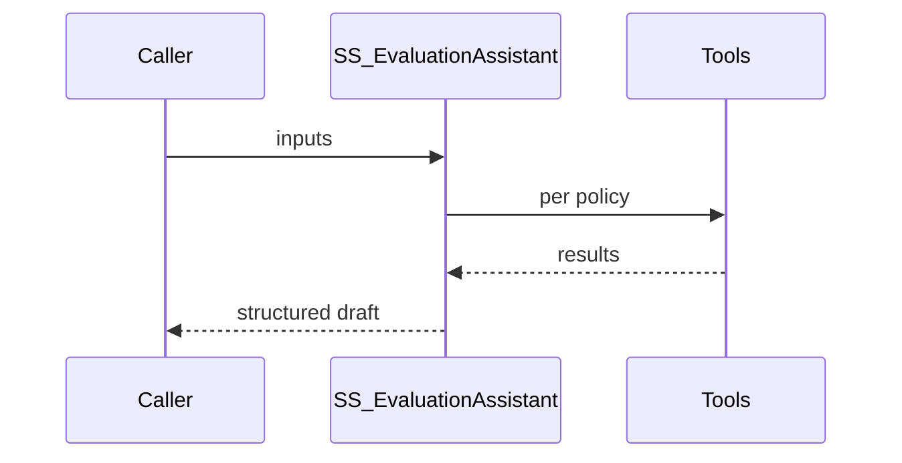

# Solution Design Document — SS_EvaluationAssistant

> **Template:** UiPath Agent — low-code (`agent.json`). Child of `source-selection-solution-sdd.md`.

---

## Document History

| Date | Version | Author | Role | Comments |
|---|---|---|---|---|
| 2026-10-12 | 1.0 | uipath-planner | Generated by AI Agent | Initial SDD |

---

<!-- DO NOT RENAME: uipath-planner detects SDDs via this exact heading or the marker below. -->
<!-- planner-handoff:v1 -->
## Planner Handoff

| Field | Value |
|---|---|
| **Status** | ready |
| **Execution autonomy** | autonomous |
| **Delivery model** | cloud |
| **SDD scope** | solution |
| **Solution root SDD** | source-selection-solution-sdd.md |
| **Solution ID** | uipath-source-selection |
| **Project SDD role** | child |
| **Independently executable** | no — Lane A derives tasks only via the Solution root |
| **Project list section** | §3 Tools + §8 Integrated Components + §9 Project Structure |
| **Tasks file** | `uipath-source-selection-tasks.md` |
| **Generated by** | uipath-planner |
| **Generation date** | 2026-10-12 |
| **Template validation** | passed |

---

## Decisions Made

| # | Decision | Picked | One-sentence reason |
|---|---|---|---|
| 1 | **Platform constraints** | Cloud; AI Trust Layer default model | No products blocked. |
| 2 | **Framework** | Low-code `agent.json` | Structured single-purpose drafting, editable in Agent Builder by any SE. |
| 3 | **Authority** | Drafts and recommends only | FAR 15.305/15.308: officials rate and decide. |

---

## Recommended Scope

**Recommendation:** SOLUTION(...) — this file covers SS_EvaluationAssistant
**Delivery model:** cloud
**Blocked by platform:** none
**Need profile:** Cut evaluator and decision-maker drafting time while keeping every statement traceable.

---

## Table of Contents

1. Agent Overview · 2. Agent Framework · 3. Tools · 4. Memory / RAG · 5. Evaluation Criteria · 6. Orchestrator Bindings · 7. Error Handling & Escalation · 8. Integrated Components · 9. Project Structure · 10. Testing Strategy · 11. Next Steps

---

## 1. Agent Overview

For one offeror and one evaluation factor, searches that offeror's proposal and drafts strengths, weaknesses, significant weaknesses, deficiencies and risks measured against the factor's stated criteria. Every finding carries a verbatim quote, volume and page. It never assigns a rating.

### In Scope

Draft findings with citations; flag where the proposal is silent on a stated criterion (a likely weakness or deficiency).

### Out of Scope

Assigning ratings, making decisions, contacting offerors, using information outside the provided record.

### Assumptions

Proposals and plans are synthetic; model selected by the AI Trust Layer default.

## 2. Agent Framework

Low-code agent. **Input:** `solicitationId`, `offerorId`, `offerorName`, `factor` (JSON: id, name, subfactors, criteria text), `pastPerformance` (JSON from SSRefVendor CPARS/FAPIIS, Past Performance factor only). **Output:** `findings` (array: kind, text, volume, page, quote, subfactor), `coverageNotes` (string). System prompt intent: act as a federal source selection support analyst; use only provided content and tool results; cite every claim; never rate or decide; output strict JSON.

## 3. Tools

| Tool | Type | Binding | Purpose |
|---|---|---|---|
| `SearchProposal` | Context Grounding | index `SS-Proposals-<solicitationId>`, filtered to offerorId | Retrieve proposal passages with volume/page metadata |

### Tool Invocation Policy

Call SearchProposal at least once per subfactor (max 6 calls); never cite a passage not returned by the tool.

### Agent Configuration

| Setting | Value |
|---|---|
| Name | SS_EvaluationAssistant |
| Temperature | 0 [DEFAULT] |
| Max iterations | 8 [DEFAULT] |
| Guardrails | Output schema validation; citations must reference provided pages/findings |

### Agent Interaction Diagram

## 4. Memory / RAG

### Short-term Memory

Single invocation.

### Long-term Memory

None — the source selection record lives in Data Fabric.

### RAG Sources

Context Grounding index `SS-Proposals-<solicitationId>` (proposal PDFs from SS-Proposals bucket, page metadata).

## 5. Evaluation Criteria

### Success Metrics

≥ 90% of planted discriminators found; 100% of citations resolve to the cited page and contain the quote.

### Trajectory Evaluation

Tool calls within policy limits.

### LLM-Judge Criteria

Specific, factual, cites evidence, no rating or decision language attributed to the agent.

## 6. Orchestrator Bindings

Folder `Shared/SourceSelection`; tool bindings as in §3.

## 7. Error Handling & Escalation

### Agent-level errors

Invalid output → caller retries once, then records "Draft unavailable — evaluate manually".

### HITL Escalation

Handled by the case's action tasks; the agent never escalates itself.

## 8. Integrated Components

### RPA Processes Called as Tools

None.

### API Workflows Called as Tools

None.

### Integration Service Connectors

None.

### Integration Service Connections

None.

### IXP / Document Understanding Models

None.

### Coded Functions

None.

## 9. Project Structure

### Implementation Mode

Low-code.

### Coded Agent Structure

N/A.

### Low-code Agent Structure

`SS_EvaluationAssistant/agent.json` + `evals/eval-sets/`.

### Solution / Project Breakdown

One agent project in the solution.

### Reusable Components

Factor criteria and scales come from the evaluation plan, so the agent is solicitation-agnostic.

### Environments (DEV / UAT / PROD)

Playground.

### Non-Functional Requirements

p95 < 60 s per run; inputs/outputs traced.

## 10. Testing Strategy

### Canonical Test Case

DoD plan, Offeror B, Technical Approach: proposal omits continuous ATO monitoring → Weakness citing the cybersecurity section page; strength for automated migration factory citing its page.

### Evaluation Dataset

≥ 12 cases across both plans, including silent-proposal and conflicting-evidence cases.

### Regression Strategy

Run the eval set on each change; block publish below the success metrics.

## 11. Next Steps

Lane A via the solution root.
