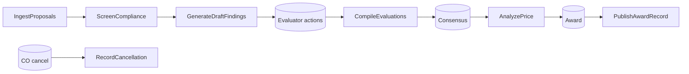

# Solution Design Document — SS_Robots (Source Selection deterministic work)

> **Template:** Coded Function — Python, single project, eight entry points (revised 2026-10-12 from coded C#). Child of `source-selection-solution-sdd.md`.

---

## Document History

| Date | Version | Author | Role | Comments |
|---|---|---|---|---|
| 2026-10-12 | 1.0 | uipath-planner | Generated by AI Agent | Initial SDD |
| 2026-10-12 | 1.1 | Claude | Build | Coded C# → Python Coded Function; added PrepareDecisionPackage (decision writer input under the 10k cap); proposal fields parsed from text until SS_ProposalExtraction (IXP) is deployed. |
| 2026-10-12 | 1.2 | Claude | Build | After live run 75b248fd: BR-02 drafts responsibility-concern offerors and excludes only non-compliant and SAM-excluded ones; SE-04 faults the job when a step fails, so Maestro opens a retryable incident, and only partial drafting failures are returned; PublishAwardRecord reads the signed SSDD from SSDecision.DocumentText. |

---

<!-- DO NOT RENAME: uipath-planner detects SDDs via this exact heading or the marker below. -->
<!-- planner-handoff:v1 -->
## Planner Handoff

| Field | Value |
|---|---|
| **Status** | ready |
| **Execution autonomy** | autonomous |
| **Delivery model** | cloud |
| **SDD scope** | solution |
| **Solution root SDD** | source-selection-solution-sdd.md |
| **Solution ID** | uipath-source-selection |
| **Project SDD role** | child |
| **Independently executable** | no — Lane A derives tasks only via the Solution root |
| **Project list section** | §11 Project Structure |
| **Tasks file** | `uipath-source-selection-tasks.md` |
| **Generated by** | uipath-planner |
| **Generation date** | 2026-10-12 |
| **Template validation** | passed |

---

## Decisions Made

| # | Decision | Picked | One-sentence reason |
|---|---|---|---|
| 1 | **Platform constraints** | Cloud serverless robots | Headless work, no desktop apps. |
| 2 | **Scope** | RPA Process inside the Solution | Deterministic case tasks. |
| 3 | **RPA sub-type** | Process with 7 entry points | One package, one entry point per case task. |
| 4 | **Authoring mode** | Python Coded Function (`uip function`) | Data, PDF and agent-invocation logic with unit tests; no UI; serverless; builds on macOS without Studio. |
| 5 | **Framework** | Coded entry points (no REFramework) | Each run is one solicitation; the case handles retry and sequencing. |

---

## Recommended Scope

**Recommendation:** SOLUTION(...) — this file covers the RPA Process
**Delivery model:** cloud
**Blocked by platform:** none
**Need profile:** Deterministic, plan-driven source selection steps callable from the case.

---

## Action Required — SME Review Items

| # | Section | Item | Question | Default applied | Blocking |
|---|---|---|---|---|---|
| 1 | §15 | SAM.gov live mode | Store an api.data.gov key in `SS_SamApiKey`? | Mirror mode from `SSRefVendor` | no |

> These items are marked `[SME REVIEW]` in the document. Default-carried items (Blocking = no) do not block task derivation.

---

## Table of Contents

1. Process Overview · 2. Process Map · 3. Detailed Process Steps · 4. Business Rules · 5. Data Definitions · 6. Value Mappings · 7. Exception Handling · 8. Error Handling · 9. Application Inventory · 10. Master Project Architecture · 11. Project Structure · 12. Queue Architecture · 13. Implementation Mode · 14. Packages · 15. Credentials & Assets · 16. Deployment Environment · 17. Testing Strategy · 18. Next Steps

---

## 1. Process Overview

`SS_Robots` performs every deterministic task in the SourceSelection case. Each entry point takes `solicitationId`, reads the evaluation plan from `SSSolicitation.PlanJson`, and reads/writes Data Fabric and buckets.

### Delivery Team

| Role | Name |
|---|---|
| Solution owner / SE | anagh.bhave@uipath.com |

### In Scope

IngestProposals, ScreenCompliance, GenerateDraftFindings, CompileEvaluations, AnalyzePrice, PublishAwardRecord, RecordCancellation.

### Out of Scope

UI automation; real SAM/CPARS integrations beyond optional live SAM.gov.

### Assumptions

≤ 6 offerors and ≤ 6 non-price factors per plan [DEFAULT]; proposals are text PDFs (generated), so page text extracts without OCR.

## 2. Process Map



## 3. Detailed Process Steps

### Step Summary

| # | Entry point | Output |
|---|---|---|
| 1 | IngestProposals | offerorCount |
| 2 | ScreenCompliance | complianceSummary (JSON string) |
| 3 | GenerateDraftFindings | draftFindingCount |
| 4 | CompileEvaluations | evaluationSet (JSON string) |
| 5 | AnalyzePrice | priceAnalysis (JSON string) |
| 6 | PublishAwardRecord | recordUri |
| 7 | RecordCancellation | recordUri |

### Step Details

#### Step 1 — IngestProposals

List `SS-Proposals/<solicitationId>/`; per offeror folder: read cover letter + price volume through `SS_ProposalExtraction` (IXP) → upsert `SSOfferor` (Name, UEI, CAGE) and price lines; extract page text of every volume → `SSProposalPage`; ingest the bucket prefix into Context Grounding index `SS-Proposals-<solicitationId>`; audit event.

#### Step 2 — ScreenCompliance

Per offeror: required volumes present; page counts within `submission.pageLimits`; SAM status/exclusion/expiry and FAPIIS from `SSRefVendor` (or live SAM.gov); set ComplianceStatus (Compliant / Non-compliant / Responsibility concern) + notes.

#### Step 3 — GenerateDraftFindings

For each offeror not excluded by BR-02 × non-price factor: start `SS_EvaluationAssistant` (Orchestrator job, wait) with plan factor + offeror; validate output schema; write `SSFinding` rows (Author = agent, Status = Draft, citations); audit event per finding. If no agent run succeeds, write nothing and fault the job (SE-04). If some runs fail twice, write their placeholders (BE-03) and return `error_type` `DraftsUnavailable` so the case continues.

#### Step 4 — CompileEvaluations

Read individual `SSRating` + `SSFinding` per offeror × factor; compute rating spread (index distance on the scale) and flag disagreement when spread ≥ 2 or finding conflict; return evaluationSet.

#### Step 5 — AnalyzePrice

Total evaluated price per offeror from price lines; % variance to `igce`; flag line items whose unit price differs from the IGCE line by > 25% as potentially unbalanced; write TotalEvaluatedPrice.

#### Step 6 — PublishAwardRecord

Render SSDD (signed text), SSEB consensus report and audit trail to PDF (QuestPDF) → `SS-Records/<solicitationId>/`; set Solicitation Status = Awarded, AwardeeName.

#### Step 7 — RecordCancellation

Status = Cancelled; cancellation memo PDF with CO rationale.

## 4. Business Rules

| ID | Rule | Source |
|---|---|---|
| BR-01 | All solicitation-specific behavior comes from the plan JSON | design |
| BR-02 | Agent drafting covers every offeror except those screened Non-compliant and those with an active SAM exclusion, whose offers are not evaluated (FAR 9.405(d)(4)). The CO can include either at release (`includeOfferorIds`). Other responsibility-concern offerors (SAM registration inactive or expired, no SAM record) are drafted: responsibility is determined under FAR Part 9, separately from the technical evaluation (FAR 15.305), and the CO resolves it before award (FAR 9.103). | design |
| BR-03 | Disagreement = rating spread ≥ 2 scale steps or opposite-kind findings on the same citation | [DEFAULT] |
| BR-04 | Unbalanced line threshold 25% from IGCE line | [DEFAULT] |
| BR-05 | Agent findings without a valid citation (page exists for that offeror and volume) are dropped and logged | design |
| BR-06 | Entry points are idempotent per solicitation (upsert by business key) | design |

## 5. Data Definitions

### Option A — Coded C# / Hybrid Mode

#### Transaction Data

```csharp
public record Plan(string SolicitationId, string Title, string Agency, IReadOnlyList<Factor> Factors, Dictionary<string, string[]> Scales, Panel Panel, decimal Igce, Submission Submission);
public record Factor(string Id, string Name, int Weight, string? Scale, bool EvaluatedNotRated);
public record Offeror(string OfferorId, string Name, string Uei, string Cage);
```

#### Output Data

```csharp
public record Finding(string FindingId, string OfferorId, string FactorId, string Kind, string Text, string Volume, int Page, string Quote, string Author, string Status);
public record PriceResult(string OfferorId, decimal TotalEvaluatedPrice, decimal IgceVariancePct, IReadOnlyList<string> UnbalancedLines);
```

#### Enums

`FindingKind { Strength, Weakness, SignificantWeakness, Deficiency, Risk }` — stored as strings.

### Option B — XAML Mode

Not used.

#### Transaction Data (Dictionary)

Not used.

#### Output Data (Dictionary)

Not used.

#### Status/Category Values

See Enums.

## 6. Value Mappings

### IXP fields — SS_ProposalExtraction to SSOfferor

| IXP field | Target |
|---|---|
| offeror_name, uei, cage | SSOfferor.Name, UEI, CAGE |
| clin lines (clin, description, qty, unit, unit_price, extended) | price lines (PriceLinesJson) |
| certification_signed, signatory | ComplianceNotes |

## 7. Exception Handling

| ID | Business exception | Handling |
|---|---|---|
| BE-01 | Missing volume | ComplianceStatus Non-compliant with note |
| BE-02 | Excluded or inactive SAM | Responsibility concern |
| BE-03 | Agent output invalid twice | Write a placeholder finding "Draft unavailable — evaluate manually" |

## 8. Error Handling

| ID | System error | Handling |
|---|---|---|
| SE-01 | Data Fabric transient | Retry 3× backoff |
| SE-02 | Agent job fault | Retry once, then BE-03 |
| SE-03 | Context Grounding ingest pending | Poll index status up to 5 min |
| SE-04 | Any step fails (exception, or no SS_EvaluationAssistant run succeeds) | The case entry point `run` raises `StepFailed`, so the job faults and Maestro opens an incident that can be retried. A returned `error_type` would let the case task complete and the next task start on missing data. Every step's output feeds the next task or is the official record, and every step is idempotent (BR-06), so a retry is safe. The one partial result that is returned instead of raised is `DraftsUnavailable` (BE-03). |

## 9. Application Inventory

| Application | Access | Notes |
|---|---|---|
| Data Fabric | Data Service activities | SS entities |
| Storage buckets | Bucket activities | SS-Proposals, SS-Records |
| Context Grounding | Context Grounding activities/API | index per solicitation |
| Orchestrator jobs | Start job / wait | invokes SS_EvaluationAssistant |
| SAM.gov API | Direct HTTP (optional) | key in SS_SamApiKey |

### Interactive Authentication / Re-auth Handoff

None — headless.

### Integration Service Connections

None.

### IXP / Document Understanding Models

| Model | Documents | Fields | Consumer |
|---|---|---|---|
| SS_ProposalExtraction | Cover letter, price volume, reps and certs | offeror_name, uei, cage, clin lines, total_price, certification_signed, signatory | IngestProposals |

## 10. Master Project Architecture

### Option A — Master Project (multiple queue-connected sub-projects)

Not used.

#### Sub-projects overview

N/A.

#### Data flow diagram

See §2.

### Option B — Single Project

Single coded project, seven entry points, orchestrated by the case.

## 11. Project Structure

### Solution / Project Breakdown

| Project | Type | Entry points |
|---|---|---|
| `SS_Robots` | Coded RPA Process (C#, cross-platform) | IngestProposals, ScreenCompliance, GenerateDraftFindings, CompileEvaluations, AnalyzePrice, PublishAwardRecord, RecordCancellation |

### Reusable Components

`Plan.cs` (plan loader), `Repo.cs` (entity I/O), `Audit.cs` (audit events), `Pdf.cs`.

### Project Type

Process.

### Project Mode Decision

Coded C#, cross-platform for serverless robots.

### Recommended Structure

#### REFramework layout (for Performer projects)

Not used.

#### Sequence layout (for Dispatcher / Reporting / simple projects)

Not used.

#### Coded layout (for Coded C# projects — §13)

```
SS_Robots/
  project.json
  IngestProposals.cs ScreenCompliance.cs GenerateDraftFindings.cs CompileEvaluations.cs AnalyzePrice.cs PublishAwardRecord.cs RecordCancellation.cs
  Shared/ Plan.cs Repo.cs Audit.cs Pdf.cs Price.cs Disagreement.cs
  Tests/
```

### Workflow Inventory

| File | Responsibility | Steps |
|---|---|---|
| one `.cs` per entry point | §3 | 1–7 |
| Shared/*.cs | helpers | all |

### UI Element Groups (selector inventory)

None.

### Workflow Dependencies

Entry points → Shared.

## 12. Queue Architecture

Not used — the case orchestrates.

### Queue Definitions

None.

### Queue Configuration

#### `—` — configuration

None.

### Queue Item Schema

#### `—` — SpecificContent fields

None.

#### `—` — Output / Analytics fields

None.

### Queue Processing Rules

None.

## 13. Implementation Mode

Coded C#.

## 14. Packages

| Package | Purpose |
|---|---|
| UiPath.System.Activities | Orchestrator, buckets, jobs, Data Service |
| UiPath.IntelligentOCR.Activities / IXP activities | Extraction |
| UiPath.Testing.Activities | Coded tests |
| QuestPDF, UglyToad.PdfPig | PDF render / page text |

## 15. Credentials & Assets

| Asset | Type | Default |
|---|---|---|
| SS_SamApiKey | Secret | empty → mirror [SME REVIEW] |
| SS_Folder | Text | Shared/SourceSelection |

## 16. Deployment Environment

### Robot & Runtime

Serverless cloud robots.

### Environments (DEV / UAT / PROD)

Playground only.

### Development & Production Hosts

Playground.

### Runtime Prerequisites

Entities, buckets, index and agents deployed first.

### Scalability & Concurrency

One job per case task.

### Operational Support

`tools/reset.py` restores demo state.

### Security & Data Handling

Synthetic proposals; folder-scoped resources.

### Delivery Quality Gates

Golden-plan tests pass.

### Non-Functional Requirements

Drafting for 3 × 3 in under 10 minutes.

## 17. Testing Strategy

### Requirements Traceability

Entry point ↔ case task ↔ test.

### Canonical Test Case

DoD plan: 3 offerors ingested, 1 FAPIIS concern flagged, 9 agent runs, ≥ 3 cited findings each.

### Happy Path Assertions

Every finding citation resolves to an existing SSProposalPage.

### Exception Test Cases

Missing volume; excluded vendor; invalid agent output.

### System Error Scenarios

Agent job fault retry; DF transient.

### Non-Functional Tests

Idempotent re-run produces no duplicates.

### UAT Acceptance Criteria

Both plans run end to end with no code change.

### Test Data & Cleanup

`tools/generate_proposals.py`, `tools/seed.py`, `tools/reset.py`.

### Production Verification

Smoke run after deploy.

### End-to-End Pipeline Test (Master Project only)

Solution level.

## 18. Next Steps

Lane A via the solution root.

### Terminal artefact — packaging per the §11 Project Mode Decision

Packed into the `.uipx` via `uipath-solution`.
